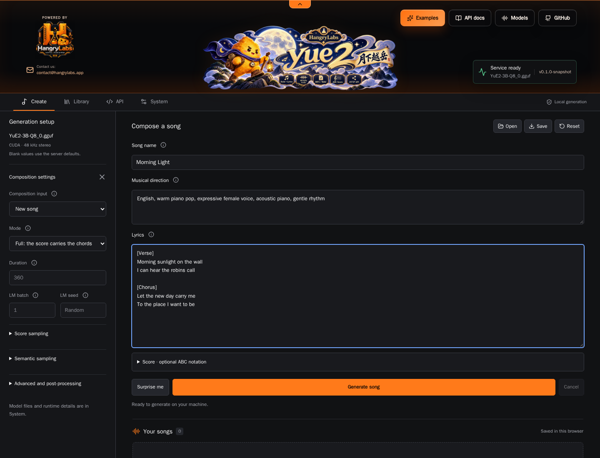

<p align="center">
  
</p>

<p align="center"><strong>English</strong> · <a href="README.nb.md">Norsk bokmål</a> · <a href="README.pl.md">Polski</a> · <a href="README.ja.md">日本語</a> · <a href="README.zh.md">简体中文</a> · <a href="README.es.md">Español</a></p>

<p align="center"><a href="https://hangry-labs.github.io/yue2/examples/?lang=en"><strong>🎧 Listen to generated songs</strong></a></p>

# Hangry Labs YuE2

**[Listen to generated songs](https://hangry-labs.github.io/yue2/examples/)** ·
[Project website](https://hangry-labs.github.io/yue2/) ·
[Documentation](https://hangry-labs.github.io/yue2/docs/)

Version **v1.0.0**. See the [version history](#version-history).

Local song generation from style tags and lyrics in a Docker container, with a
browser studio, HTTP API and stereo 48 kHz audio in Opus, MP3, FLAC, WAV and more.

Write your lyrics, describe the music and generate a song on your own GPU.
Keep the audio, edit the ABC score or reuse the generated semantic tokens and
acoustic latents for another take. This Hangry Labs fork packages the
[yue2.cpp](https://github.com/ServeurpersoCom/yue2.cpp) engine as C++20 with GGML, a
local studio, Docker workflows and a repeatable generation baseline.

## Quick Start

Use Docker with NVIDIA GPU support and a driver compatible with the CUDA 12.9.1
runtime. The tested machine has an **RTX 5070 Ti with 16 GB VRAM**; other GPU
configurations have not been qualified.

**One-time setup:** put the [two model files](#model-downloads) in `data/models/`.
Then start the studio with one command from the directory containing that folder.
These commands pin the published stable `v1.0.0` image and its verified OCI digest.

**Bash:**

```bash
docker run -d --name yue2 --restart unless-stopped --gpus all -p 127.0.0.1:8087:8087 --mount "type=bind,source=$(pwd)/data/models,target=/models,readonly" --mount type=volume,source=yue2-output,target=/output hangrylabs/yue2:v1.0.0@sha256:446bd69099513f8b1d762656d455826872b7221ab232aa05e907f3ada90c9b34
```

**PowerShell:**

```powershell
docker run -d --name yue2 --restart unless-stopped --gpus all -p 127.0.0.1:8087:8087 --mount "type=bind,source=$($PWD.Path)\data\models,target=/models,readonly" --mount type=volume,source=yue2-output,target=/output hangrylabs/yue2:v1.0.0@sha256:446bd69099513f8b1d762656d455826872b7221ab232aa05e907f3ada90c9b34
```

Open **[http://localhost:8087](http://localhost:8087)**, enter style tags and
lyrics, then select **Generate**. No host compiler or Python is needed to run
the published image. The container includes the studio and native tools;
**model weights stay outside the image and are not downloaded by the server**.
Generation can run offline once the image and models are present.

<details markdown="1">
<summary><strong>First run: model downloads and checksums</strong></summary>

<a id="model-downloads"></a>

Create `data/models/` and save these two files there, keeping their filenames.
Downloads total approximately 4.34 GB. The links use the pinned publisher
revision in the [model manifest](docker/models.json), which includes SHA-256 checksums.

| Download | Purpose | Size |
| --- | --- | --- |
| [YuE2-3B-Q8_0.gguf](https://huggingface.co/Serveurperso/YuE2-GGUF/resolve/e630f2b8f6aedf8254c3186438633c1b5eeaf80a/YuE2-3B-Q8_0.gguf) | Song generation backbone | 3.81 GB |
| [YuE2-Vae-F32.gguf](https://huggingface.co/Serveurperso/YuE2-GGUF/resolve/e630f2b8f6aedf8254c3186438633c1b5eeaf80a/YuE2-Vae-F32.gguf) | Audio encoder/decoder | 530 MB |

</details>

For automatic model download and checksum verification from a checkout, use
`task models`. To build locally, see [Local Development](#local-development).
Existing checkouts can [migrate local data](docs/DEVELOPMENT.md#local-data)
without downloading the models again.
Model terms are separate from the application's MIT license; see [License](#license).

## What You Get

- Style-and-lyrics song generation with full score, melody-only and no-score modes.
- Stereo 48 kHz audio, browser playback and [nine output formats](docs/AUDIO.md).
- Editable ABC scores, semantic-token replay and continuation from source tokens.
- A browser library with search, favorites and prompt reuse.
- Local LoRA adapters and VAE audio/latent encoding and decoding.
- Asynchronous HTTP jobs with progress logs and cancellation.
- Queue capacity, persistent result usage, model availability and live NVIDIA GPU charts in System.

Recording transcription and audio tokenization require additional models and
server arguments. They are optional and are not included in the default
downloads. See [Models](docs/MODELS.md).

## Browser UI

Choose English, Norwegian Bokmål, Polish, Japanese, Simplified Chinese or Spanish
in the header. Direct links are `/en`, `/nb`, `/pl`, `/ja`, `/zh` and `/es`.
The browser remembers your choice; switching preserves lyrics, direction,
settings, saved songs and active work. Interface language does not select the
singing language or translate your lyrics. Describe the singing language in
musical direction and supply the words you want sung.

<p align="center">
  <a href="assets/screenshots/create-ui.webp">
    
  </a>
</p>

| View | What you can do |
| --- | --- |
| Create | Enter musical direction and lyrics, edit an optional ABC score, adjust generation settings and play rendered songs. |
| Library | Search saved songs, mark favorites, download artifacts and reuse prompts. |
| API | Read native HTTP examples and the asynchronous job workflow. |
| System | Inspect configured models and optional tools, NVIDIA GPU activity and server logs. |

The studio uses the Hangry Labs charcoal-and-orange theme with a collapsible
header. Switching views preserves the current composition and active generation.
Examples fill the song content while preserving generation settings. UI assets
are served locally without a CDN.

Playback volume and mute are at the top of the left rail in Create and Library,
and stay visible above collapsed generation settings on mobile. New browser
sessions default to 100%, preserving the original level for a single track;
saved volume choices are retained. Several simultaneous tracks share mix
headroom. Listening controls never change generated or downloaded audio.

**Generate song** starts a new composition from the current lyrics and musical
direction, with random seeds and 8 refinement steps by default. Each setting has
an info button explaining its effect. Generated scores and replay data stay with
their saved songs in Library. **Edit prompt** reuses the text for a fresh take;
**Use this score**, **Replay this take** and **Continue source** explicitly reuse
earlier musical material. Fixed seeds remain available for repeatable tests.

## Docker Reference

### Image Tags

One CUDA image is published to both registries:

- Docker Hub: [`hangrylabs/yue2`](https://hub.docker.com/r/hangrylabs/yue2)
- GHCR: `ghcr.io/hangry-labs/yue2`

| Tag | Meaning | Models |
| --- | --- | --- |
| `latest` | Moving development build from `master` | External read-only mount |
| `v1.0.0` | First stable application release | External read-only mount |

For GHCR, replace the image in the quick start with
`ghcr.io/hangry-labs/yue2:v1.0.0@sha256:446bd69099513f8b1d762656d455826872b7221ab232aa05e907f3ada90c9b34`.
Both registries expose the same verified top-level OCI index. See the
[v1.0.0 release](https://github.com/hangry-labs/yue2/releases/tag/v1.0.0) for image
references and qualification results. The `ggml-deps-*` GitHub Releases contain
build libraries, not runnable song-generation images.

See the [Docker guide](docs/DOCKER.md), [publication rules](docs/RELEASING.md)
and prepared [Docker Hub overview](docs/dockerhub.md).

### Persistent Data

| Storage | Contents and lifetime |
| --- | --- |
| Host `data/models/` mounted at `/models` | Required GGUFs; survive container replacement |
| Optional host `data/adapters/` mounted at `/adapters` | LoRA files; see the [Docker guide](docs/DOCKER.md#runtime-settings) |
| Browser IndexedDB | Saved song cards, audio and latent artifacts |
| Browser localStorage | Form settings and pending-job state |
| Server memory | Active/queued jobs and small metadata; no retained audio bodies |
| Persistent `/output` mount | Native/API results and replay metadata (24 hours); MCP links (one hour) |

Export songs you want to keep. The model mount does not back up browser storage;
using a different browser or service address opens a separate browser library.
All completed server results use the output volume and survive restarts until
expiry. Defaults are 10 GiB / 256 native results; live results are not evicted
early. See [queue limits and storage](docs/QUEUE.md) and [agent tools](docs/MCP.md).

### Runtime Settings

Normal startup preserves the upstream **24,576-token context**, automatic
backend selection and strict model eviction between stages. Request defaults
use **8 flow-matching steps**, matching the repeatable benchmark. This is an
intentional change from upstream's 32-step default.
Existing browser form settings control subsequent UI requests.

Server settings are command-line arguments, not `YUE2_*` container environment
variables. Supplying arguments replaces the image's default command; include
the model paths and network binding. See [runtime settings](docs/DOCKER.md#runtime-settings)
for context, GPU selection, adapters and persistence.

## API Examples

Agents can connect to **`http://localhost:8087/mcp`**: read the songwriting skill,
submit lyrics and direction, then retrieve an HTTP audio link valid for one hour.
Only basic musical controls are exposed. See the [MCP guide](docs/MCP.md).

Use `/v1/audio/music` for direct music files or `/v1/audio/speech` with OpenAI
clients. Both share the existing serial queue. See [music/SDK examples](docs/API.md),
the local guide at `http://localhost:8087/docs`, and `/openapi.json`.

The studio and native HTTP API share port **8087**. Submit a request, poll its
job ID and fetch the result when the status is `done`. The API uses the native
music protocol rather than an OpenAI speech contract.

**Bash, with cURL:**

```bash
curl --fail-with-body http://localhost:8087/synth -H 'Content-Type: application/json' --data '{"style":"acoustic pop, warm vocals, gentle guitar","lyrics":"[verse]\nMorning light across the floor\nA little song outside the door","cot":"full","duration":30,"steps":8,"output_format":"mp3"}'
```

The response is `{"id":"..."}`. Replace `JOB_ID` below with that value, poll
until the status is `done`, then fetch the result:

```bash
curl --fail-with-body "http://localhost:8087/job?id=JOB_ID"
curl --fail-with-body "http://localhost:8087/job?id=JOB_ID&result=1" --output song.multipart
```

A synthesis result is **`multipart/mixed`**, with replay JSON, encoded audio and
acoustic latents for each track. `song.multipart` preserves that response; it is
not an MP3 file. Use the browser for individual downloads or parse the parts in
your client. To cancel, send `POST /job?id=JOB_ID&cancel=1`.

`GET /status` and `GET /system/queue` report shared queue capacity and result storage.
Excess submissions return 429 with `Retry-After: 5`; see [retry behavior](docs/QUEUE.md).
`GET /props` describes configuration and capabilities; `GET /health` reports
liveness, `GET /logs` streams progress, and `GET /system/gpu` reports GPU
telemetry. See the [API and CLI reference](docs/ARCHITECTURE.md#endpoints).

## Local Development

Install Docker with NVIDIA GPU support, Python 3.11+ and [Task](https://taskfile.dev).
The C++/CUDA compiler and Node tools run inside Docker.

```text
git clone https://github.com/hangry-labs/yue2.git
cd yue2
task doctor
task init
task start
```

`task init` downloads/verifies the two external GGUFs and builds `yue2:dev`.
Normal Task/CI builds reuse a checksum-pinned **GGML 0.28.0/CUDA dependency archive**
to skip expensive kernel compilation. It contains libraries and headers, with
no model weights. Source builds fetch the exact official GGML archive into their
build directory; the full source is not kept in this repository. The previous
dependency artifact remains available for rollback. See [build dependencies](docs/BUILDING.md).

| Task | Purpose |
| --- | --- |
| `task build` | Rebuild the app and UI |
| `task start` / `task stop` | Start or stop the local development server |
| `task status` / `task logs` | Inspect the container or follow logs |
| `task validate` | Check tooling, dependency pins, UI and native CPU build |
| `task test1` | Run the fixed-seed, 8-step GPU generation baseline |
| `task benchmark-plan` | Inspect the resident-model benchmark workload without a GPU |
| `task benchmark-baseline` | Measure warm generation, VRAM and four-language lyric fidelity |
| `task benchmark-long` | Measure five English long songs with resident models and no ASR |

Copy `.env.example` to `.env` for local Task settings. CLI overrides include
`task start PORT=8088` and `task test1 SEED=123`; use `PYTHON=python3` where
needed. Run `task --list` for all commands and see the
[development guide](docs/DEVELOPMENT.md) for repository layout and native builds.

## Benchmarks

The initial local baseline generated **270.8 seconds of audio in 85.1 seconds
of pipeline time** on an RTX 5070 Ti 16 GB, using the Q8_0 backbone, F32 VAE,
full score generation, 8 steps and fixed seeds. Total wall time was 90.5 seconds.
Model hashing warmed the filesystem before measurement; this is one local run,
not a performance guarantee.

`task test1` uses [the recorded prompt](tests/fixtures/test1.txt) and saves audio,
score, tokens, latents, replay settings, logs and timings under `data/results/test1/`.
See [methodology and measured results](docs/BENCHMARKS.md).

For repeatable warm inference measurements, use [the benchmark suite](benchmarks/README.md).
It keeps weights resident, excludes full warmups, measures 30-second songs in
four languages, and uses your remote ASR service to score lyric fidelity. Speed,
sampled GPU memory and lyric scores have [separate reports](benchmarks/BENCHMARKS.md)
and matched before/after regression checks.

## Documentation

See the [documentation index](docs/README.md) for user and developer guides.

- [Docker runtime and packaging safeguards](docs/DOCKER.md)
- [Models, checksums and conversion](docs/MODELS.md)
- [LoRA adapters](docs/ADAPTERS.md)
- [Development and repository layout](docs/DEVELOPMENT.md)
- [Reusable CUDA build dependencies](docs/BUILDING.md)
- [Benchmark methodology](docs/BENCHMARKS.md)
- [CI and releases](docs/RELEASING.md)
- [Architecture, API and CLI reference](docs/ARCHITECTURE.md)
- [Docker Hub overview](docs/dockerhub.md)
- [Listening gallery and generation recipes](examples/README.md)
- [Website preview and Pages deployment](docs/WEBSITE.md)

## Version History

<details markdown="1">
<summary><strong>v1.0.0 · First stable release</strong></summary>

### v1.0.0

First stable application release, published on November 3, 2026. See the
[release notes](https://github.com/hangry-labs/yue2/releases/tag/v1.0.0).

- Package the C++20/GGML song engine and standalone studio for CUDA in Docker.
- Add Create, Library, API and System views with GPU telemetry and six interface languages.
- Provide native HTTP jobs, OpenAI-compatible music/speech transport and restricted MCP song tools.
- Bound the generation queue and persist completed results with configurable retention.
- Support FFmpeg audio import/export and an Opus listening gallery with reusable prompts.
- Retry malformed generated scores and offer two acoustic variations by default, up to three.
- Keep weights external, with pinned model downloads and mandatory image checks.
- Add 8-step defaults, speed/VRAM/lyric benchmarks and verified reusable CUDA libraries.
- Configure publication of the same image to Docker Hub and GHCR.

</details>

## Responsible Use And Privacy

Generation runs on your machine. Image/model downloads contact their respective
registries and model host; the packaged studio requires no external UI assets.
The quick start exposes HTTP on localhost. Browser pairing and external product
integrations are not implemented.

Use lyrics, scores and recordings you have rights to process. Obtain consent
where recordings identify other people, avoid deceptive impersonation, and
review generated material before sharing it. Check the model's non-commercial
terms for your intended use.

## Upstream Attribution

[MAP's YuE2](https://huggingface.co/m-a-p/YuE2-3B) provides the song model and
[YuE2-Vae](https://huggingface.co/m-a-p/YuE2-Vae) the audio codec.
[yue2.cpp](https://github.com/ServeurpersoCom/yue2.cpp) provides the native engine
and original studio, using a patched GGML fork. Hangry Labs maintains this
fork's product UI, Docker packaging, workflow organization and baseline tooling.
See [model provenance](docs/MODELS.md) and [third-party notices](THIRD_PARTY_NOTICES.md).

## License

Application source is [MIT](LICENSE). The model weights have separate
**CC BY-NC 4.0** terms; keeping them outside the image does not change those
terms. CUDA and other runtime dependencies retain their own licenses, so the
complete container is not covered by a single MIT grant. No weights are shipped
in the image; see [packaging safeguards](docs/DOCKER.md#weight-free-packaging).
